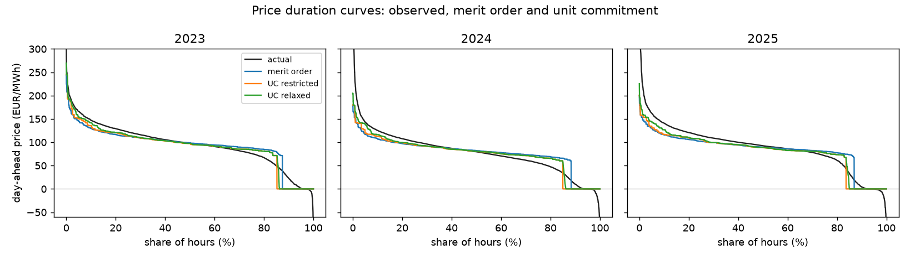
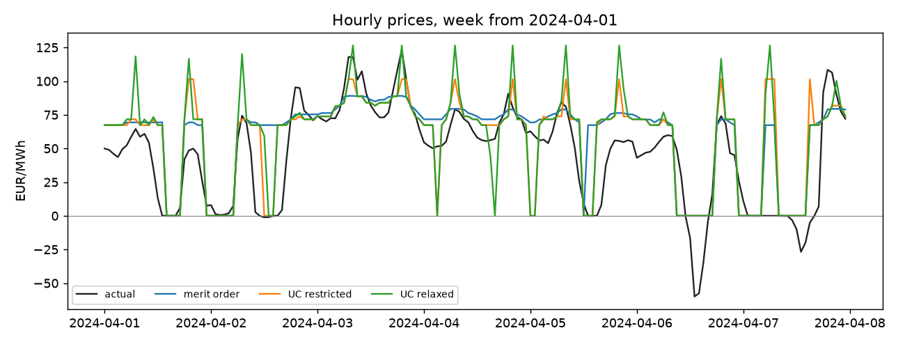
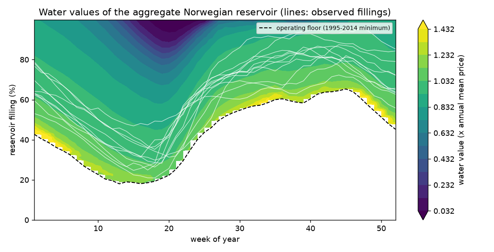
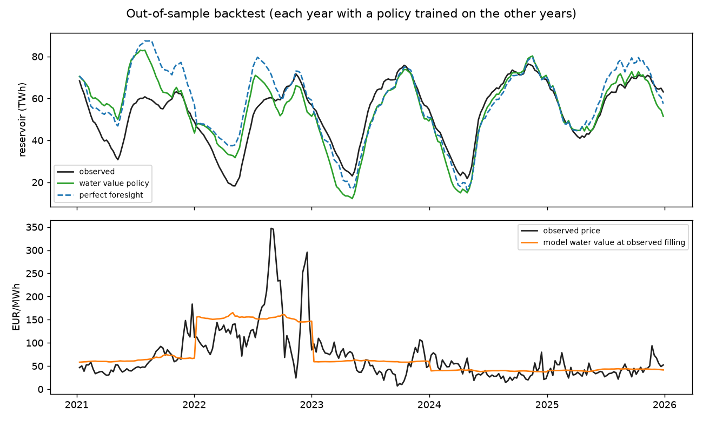

# Unit commitment of the German thermal fleet and water values of Norwegian hydropower (v0.1)

[](https://github.com/michaelserikov/nordic-hydro-unit-commitment/actions/workflows/tests.yml)

Two models that sit behind most power market fundamentals work, built from open data:

1. **Unit commitment (MILP) of the German lignite, hard-coal and gas fleet**, hourly, 2023-2025. It extends the merit-order model of [de-power-market-ppa](https://github.com/michaelserikov/de-power-market-ppa) (v0.4) with minimum stable output, minimum up and down times and start-up costs, and asks how much of the gap between a merit order and observed prices these constraints explain.
2. **Water values of the aggregate Norwegian reservoir** by stochastic dynamic programming, weekly, 2015-2025, with an out-of-sample backtest against the observed operation and against perfect foresight.

**Unit commitment: main findings**
- Adding minimum output, minimum up and down times and start-up costs to the merit-order model lowers the hourly price error out of sample from 20.3 to 18.9 EUR/MWh (2024) and from 22.6 to 21.0 EUR/MWh (2025), about 7%, and raises the hourly correlation with observed prices from 0.71-0.73 to 0.74-0.77 (relaxed prices). Nothing else changes: same data, same fleet, same calibrated inputs.
- Most of the gain comes from the dynamics, not from minimum output: with start-up costs and minimum up and down times removed, the 2024 error is 20.1 EUR/MWh, almost the merit-order value. Relaxed prices carry the start-up cost of peaking units into the morning and evening ramps, where observed prices also rise.
- The model also splits thermal output more like reality. Lignite was overestimated by 12-15% in the merit order and is now 9-11% too high; gas was underestimated by 12-15% and is now 8-11% too low; hard coal stays within 5%. Part of the gas fleet runs for heat and system services, which neither model sees.
- Thermal units start more often as renewables grow: about 1,170 lignite, 1,310 hard-coal and 4,000 gas unit starts in 2023 against 1,490, 1,420 and 5,190 in 2025 (with the assumed unit sizes; an indicator of cycling, not plant data).
- What it still misses is the tails. Inflexible output leaves more hours at a zero price (14-15% of hours against 4-8% observed at or below zero) because the model has no exports, storage or flexible demand to absorb it, and the best fit gives surplus output no negative price at all; scarcity spikes above about 270 EUR/MWh do not appear. These are the next things to model.

**Water values: main findings**
- The water value map has the textbook shape: water is worth most near the operating floor in late winter (up to about 1.4 times the annual mean price) and least when the reservoir is full before the spring flood (week 20), when more water risks spillage.
- Out of sample (each year 2016-2025 operated with a policy trained on the other nine years), knowing the whole year's inflows and prices in advance would add only **2.0%** to the value achieved with the water values (0.6-3.3% per year). The water values capture most of what the reservoir can earn from timing.
- The model policy follows the observed reservoir closely in normal years (mean absolute filling error 2.7-4.5 TWh in 2017, 2019, 2020, 2024 and 2025, on an 87 TWh reservoir) and departs from it most in 2021-2023 (7 to 13 TWh), the years of the energy crisis, when prices were driven by continental gas and the observed reservoir was drawn down further in spring 2021 and 2022 than the model would have.
- Against the observed operation the price-taking policy earns 12% more over 2016-2025. This is an **upper bound, not a finding about the operators**: a price taker ignores that moving several TWh between weeks would itself move Nordic prices, and the observed revenue is valued at an average Norwegian price, not at each plant's own price. The gap is largest in 2020 (very low prices and large inflows) and 2022 (energy crisis).

## Part 1: unit commitment

**Fleet and inputs.** Hourly SMARD data 2023-2025 (Bundesnetzagentur, CC BY 4.0): load, wind, solar and generation by fuel. Thermal demand per hour is what load leaves for lignite, hard coal and gas after all other sources and net imports, exactly as in the merit-order model, so the model decides how that demand is split between plants and what it costs at the margin; the split is checked against observed generation by fuel. Fuel and carbon prices are monthly (World Bank Pink Sheet TTF and coal, ECB exchange rate, EEX auction prices). Per fuel and month, available capacity is the maximum observed output and must-run (heat, system services) its 15th percentile; both parameters and the lignite fuel cost (4 EUR/MWh thermal) are taken unchanged from the merit-order calibration on 2023.

**Formulation.** The capacity above must-run is split into four efficiency classes per fuel (gas: two CCGT classes and two open-cycle classes). Each class is a cluster of identical units with an integer number online (clustered unit commitment, Palmintier and Webster 2014):

| unit type | size (MW) | minimum output | min up / down (h) | start-up cost (EUR per MW) |
|---|---|---|---|---|
| lignite | 500 | 40% | 8 / 6 | 70 |
| hard coal | 400 | 35% | 6 / 4 | 55 |
| CCGT | 400 | 40% | 4 / 2 | 45 |
| open-cycle gas | 100 | 20% | 1 / 1 | 25 |

These are typical literature values, not plant data; a sensitivity run doubles the start-up costs and another removes start-up costs and minimum up and down times. Surplus inflexible output (minimum output plus must-run above thermal demand) is absorbed at a cost that becomes a negative price; its level is the one new parameter, calibrated on 2023 (grid 0, 10, 25, 50 EUR/MWh). Days are solved in sequence over 24 + 12 hours with SciPy's HiGHS MILP solver, and the commitment and start history carry over.

**Prices from a MILP.** A MILP has no dual prices. Two standard constructions are reported: *restricted* prices fix the commitment at the MILP solution and take the dual of the demand constraint (the marginal cost of the marginal online unit); *relaxed* prices are the duals of the LP relaxation, which spreads start-up costs and minimum output into the price, close to convex-hull pricing.

**Results** ([results/uc/metrics.csv](results/uc/metrics.csv), 2023 calibration, 2024-2025 out of sample):

| | 2023 MAE | 2024 MAE | 2025 MAE | hourly correlation 2023 / 2024 / 2025 |
|---|---|---|---|---|
| merit order | 20.9 | 20.3 | 22.6 | 0.74 / 0.71 / 0.73 |
| UC, restricted prices | 20.3 | 19.2 | 21.3 | 0.76 / 0.73 / 0.76 |
| UC, relaxed prices | 20.3 | 18.9 | 21.0 | 0.77 / 0.74 / 0.77 |

MAE in EUR/MWh. Calibration of the surplus cost on 2023: 0, 10, 25 and 50 EUR/MWh give relaxed MAE 20.3, 21.4, 23.3 and 26.4, so 0 is used. Sensitivity on 2024 (relaxed): without start-up costs and minimum up and down times 20.1, with doubled start-up costs 19.3. Generation by fuel: [results/uc/generation_by_fuel.csv](results/uc/generation_by_fuel.csv); unit starts: [results/uc/unit_starts.csv](results/uc/unit_starts.csv). In five hours of the three years less than 0.3 MW of demand is left unserved (solver tolerance).





**Limitations.** Thermal demand is taken from the data, so imports, exports, storage and demand response are fixed at their observed values; capacity and must-run are derived from observed output, not from a plant list; unit parameters are typical values; no ramping limits, reserves or network. A daily rolling horizon with 12 hours of look-ahead, solved to a 0.1% MIP gap.

## Part 2: water values

**Data.** Weekly reservoir filling and capacity for Norway (NVE reservoir statistics, 1995 onwards, total capacity 87.4 TWh); hourly generation of Norwegian reservoir plants and day-ahead prices of NO1-NO5 (Energy-Charts, Fraunhofer ISE, from ENTSO-E data, 2015 onwards). Weekly inflow is implied by the water balance (change in filling plus generation), so it is net of spillage and pumping. The weekly price is the average of NO1-NO5 weighted by each area's reservoir capacity.

**Model.** One aggregate reservoir, weekly stages, release between the lowest and highest weekly generation observed (1.2 and 3.9 TWh), spillage allowed. The operator knows this week's inflow and price but not the future ones; the expectation runs over the historical years, keeping inflow and price of the same week together. The year is periodic: the backward recursion is repeated until the value function stops changing (5% annual discount rate). The water value is the slope of the value function. Norwegian producers keep reservoirs well above empty for security of supply, so the model may not go below the lowest filling observed for each week in 1995-2014, before the sample.

**Price scaling.** A price-taking producer's optimal policy is unchanged if all prices are multiplied by a constant, so the model is trained on prices divided by their annual mean and its water values are in multiples of the annual mean price. In the backtest they are multiplied by that year's mean price: the comparison with observed prices tests timing and shape, not the price level, which no reservoir model can know a year ahead.

| | 2016-2025 total |
|---|---|
| value with water values, million EUR | 64,315 |
| value with perfect foresight | 65,582 (+2.0%) |
| value of the observed operation (same terms) | 57,202 |

End-of-year storage differences are valued at the model water value so that all three are compared on the same terms. Per-year results: [results/hydro/backtest_by_year.csv](results/hydro/backtest_by_year.csv).





**Limitations.** One aggregate reservoir (no cascades, no area transmission limits), a price taker, inflow implied by the water balance and weeks treated as independent (no persistence of dry or wet years in the scenarios). Within a year the model water value is smooth, while weekly prices also move with continental gas prices and wind, which a one-reservoir model does not see: the weekly correlation between the water value at the observed filling and the observed price is low (median 0.14).

## Run

```
python -m venv .venv && .venv/Scripts/activate      # or source .venv/bin/activate
pip install -e ".[test]"
python -m nhuc.uc_run       # unit commitment 2023-2025 (about 25 minutes on 4 cores)
python -m nhuc.hydro_run    # water values and backtest (about 2 minutes)
pytest -q                   # synthetic tests, no data needed
```

Data are downloaded once into `data/raw/` (not committed). Results are in `results/uc/` and `results/hydro/`, figures in `figures/`.

## Code

- `src/nhuc/uc.py`: clustered unit commitment, rolling horizon, restricted and relaxed pricing
- `src/nhuc/merit.py`: merit-order baseline (from de-power-market-ppa v0.4)
- `src/nhuc/water_values.py`: SDP, policy simulation, perfect-foresight LP
- `src/nhuc/smard.py`, `fuels.py`, `de_data.py`, `hydro_data.py`: data
- `tests/`: unit commitment against hand-checked cases (merit-order prices without dynamics, dumping at minimum output, minimum up time, carried state) and SDP checks (concave value function, deterministic SDP equals perfect foresight, floor respected)

Research study on public data; illustrative unit parameters, not a market forecast.
